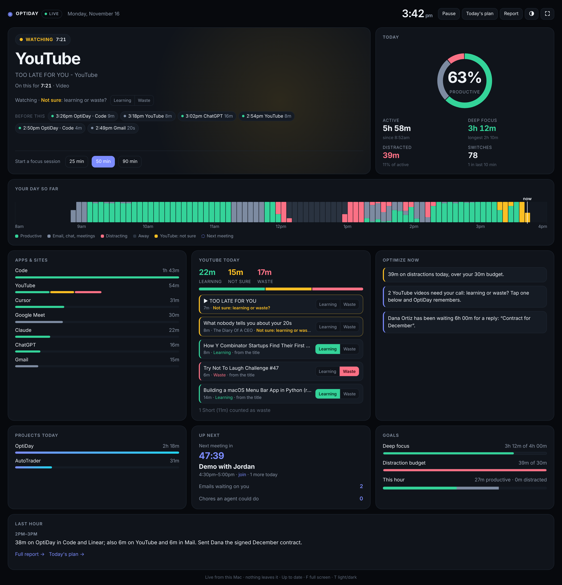
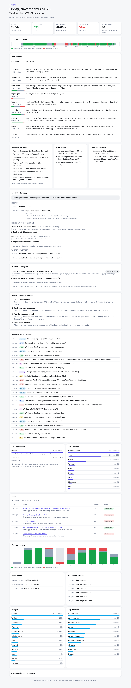

# OptiDay

A private Mac app that watches what you do all day and tells you **what you got done, hour by
hour**, where your time went, and how to work better tomorrow. Every evening it also **gets
tomorrow ready**: your meetings with context, the emails waiting on you with reply drafts, where
you left off, and repetitive chores it can hand to an agent once you approve.
And it has a **live tracker** you can leave open on a side monitor all day.
Everything runs on your Mac (or on a private server you own). Nothing goes to any cloud.



## Live view on a side monitor (new in v0.4)

Click **◉ → Live view** in the menu bar (or run `~/.local/bin/optiday live`). It updates the
moment you switch apps and shows:

- **Right now**: what you're on and for how long, whether you're *in flow*, *focused*, on
  *email & chat*, *drifting* or *away*, and the last few things you did before this.
- **Today**: productive %, active time, deep focus, time lost to distractions, and app switches.
- **Your day so far**: a 5-minute timeline from your first minute today until now, with your next
  meeting marked on it.
- **Optimize now**: short, specific nudges: "8m on Reddit. Back to OptiDay?", "17 app switches
  in 10 minutes", "Demo with Jordan starts in 12m", "Dana has been waiting 6h for a reply".
- **YouTube today**: every video sorted into **Learning**, **Waste** or **Not sure**, with the
  minutes for each. When OptiDay can't tell, it says *Not sure* (amber) instead of guessing, and
  you tap **Learning** or **Waste** once. It remembers your answer for that video and for its
  channel, and learns from titles like the ones you marked (new in v0.4.1).
- **Focus session**: click 25, 50 or 90 minutes. OptiDay counts focused vs drifting time and sends
  a notification if you drift for more than a minute. It also tells you when the session ends.
- **Up next, goals and last hour**: next meeting countdown, emails waiting on you, agent chores,
  your deep-focus goal and distraction budget, and the summary of the hour that just ended.

**To keep it on your side monitor as its own window** (no browser tabs or address bar):

- **Safari**: with the Live view open, choose **File → Add to Dock**, then open OptiDay from the
  Dock and drag the window to your second monitor.
- **Chrome**: click the install icon in the address bar (or **⋮ → Cast, save and share →
  Install page as app**).
- Press **F** for full screen and **T** to switch between dark and light.

It costs almost no battery: the page waits for OptiDay to tell it something changed instead of
asking every few seconds, it has no animations, and it pauses its clock when the window is
hidden. Nothing leaves your Mac: the page is served only to this Mac, and other websites can't
read it. Set your goals in Settings under `[live]`.

## What you get every evening

- **Hour by hour**: one or two plain sentences for every hour of your day ("9am–10am: 55m on
  OptiDay in Code and Terminal; sent Sarah the pricing email; merged PR #12"), plus **what you
  got done** as a short list. The menu bar also shows **the last hour** as soon as it ends.
- **Ready for tomorrow**: tomorrow's meetings (from your calendar) with anything related from
  today, the emails people are waiting on with **reply drafts** written by your local AI, where
  you left off on each project, and next steps. The next morning, the first time you use your Mac,
  OptiDay opens this as your **Today** page (◉ → Today's plan).
- **Hand off to an agent**: when OptiDay sees you repeat a chore (copying between a spreadsheet
  and a dashboard, sending near-identical emails, checking the same site every day), it writes
  instructions for an agent such as Claude Code. **Nothing runs until you click Approve**, and
  you can read and edit the exact instructions first. Approved tasks run at 9am the next day
  (or now, with Run now).
- **Time per project and per app**: projects are found automatically from your code editor,
  terminal, GitHub and doc titles, and you can add your own keywords.
- **What you did, with exact times**: for example "9:01am Sent an email to sarah@… about
  'OptiDay beta pricing'", "10:07am Merged PR #12", "11:15am Google Meet: Investor sync (30m)",
  "3:02pm Worked with ChatGPT: 'Python async help'", plus the files you edited and the docs
  you wrote in.
- **Every YouTube video by name**, with how long you watched it and a verdict: *Learning*,
  *Waste of time* or *Not sure*. Learning counts as productive, waste as distracting, and not
  sure as neither until you decide. Click **Useful** or **Waste** (here or on the Live view) and
  OptiDay remembers it for that video and its channel. How it decides, in order: your answer,
  your answer for the channel, the local AI (when plugged in and the model is installed), titles
  like ones you marked, and clear words in the title ("lecture", "tutorial", "official video").
- **Focus and distraction**: deep-focus blocks, distraction stretches, how often you switched apps,
  and how often you checked email and chat, hour by hour.
- **Coaching**: what went well, where time leaked, and 3 to 5 specific changes for tomorrow,
  written by the local AI from your real day.



## Already have OptiDay? Upgrade to v0.4.1 (2 minutes)

1. Double-click **OptiDay-v0.4.1.zip** so you have a folder called **OptiDay-v0.4.1** in Downloads.
2. Open **Terminal**, paste this exact line, and press Enter:
   ```
   bash ~/Downloads/OptiDay-v0.4.1/install.sh
   ```
   Use the **v0.4.1** folder. At the end, the installer offers to delete older OptiDay folders
   in Downloads: type **y**. Your history and settings are kept (they live in Application
   Support, not in Downloads). Running an older v0.4 folder by mistake is safe: it stops,
   changes nothing, and prints the right line. The v0.2 and v0.3 folders don't have that check.
3. Click **◉ → Live view** in the menu bar.

## Install (about 10 minutes, once)

1. Double-click the downloaded zip so you have a folder called **OptiDay-v0.4.1** in Downloads.
2. Open **Terminal** and paste this line, then press Enter (it works from any folder):
   ```
   bash ~/Downloads/OptiDay-v0.4.1/install.sh
   ```
   Or double-click **Install OptiDay.command** inside the folder. If macOS says it can't be
   opened, go to System Settings → Privacy & Security, scroll down and click **Open Anyway**.

   This installs Python if needed, OptiDay itself, and **Ollama** with a local AI model sized to
   your Mac's memory (a few GB download). It also sets OptiDay to start automatically at login.
   Running it again later updates OptiDay and keeps your data.
3. **The one step only you can do.** When System Settings opens at *Screen & System Audio
   Recording*, turn on **Python** (OptiDay's engine), then click **◉ → Restart OptiDay** in the
   menu bar. The first time you use Chrome, Safari or Arc, macOS asks whether Python may control
   the browser. Click **OK** so OptiDay can see which site and video you're on.

That's it. A **◉ 2:41** appears in your menu bar showing today's active time.

- Optional but recommended, in Terminal:
  - `~/.local/bin/optiday connect-email` lets OptiDay see emails you sent (exact times) and who is
    waiting on you. It uses an **app password** (Gmail: myaccount.google.com/apppasswords) kept in
    your Keychain, and reads mail read-only: it never sends, deletes or marks anything.
  - `~/.local/bin/optiday connect-calendar` pastes your calendar's private iCal address so
    tomorrow's meetings show up in your plan.
- Want to see a report straight away? Run `~/.local/bin/optiday demo --open` for a simulated day.
- Something not working? Click **◉ → Run setup check**, or run `~/.local/bin/optiday doctor`.

## Daily use

| Menu bar ◉ | What it does |
|---|---|
| *9am–10am: …* | Summary of the last full hour. Click it for the Today page |
| Live view | The live tracker for your side monitor (see above) |
| Today's plan | Meetings, emails waiting on you with drafts, where you left off, agent tasks, hours so far |
| Open today's report | Opens the live report in your browser (served only to this Mac) |
| Agent tasks | Chores OptiDay suggests handing to an agent, waiting for your OK |
| Rebuild today's report now | Re-analyzes including the last few minutes |
| All days… | Every past day, with headline and score |
| Pause recording | Stops all capture until you resume. The icon turns into ⏸ |
| Settings… | Opens `config.toml` (report time, privacy list, AI model, projects) |

The report builds itself at **6:00pm** (change `[report] time`), sends a notification and opens.
If your Mac was asleep at that time, it builds the next time OptiDay starts.

Handy commands: `optiday live` (opens the Live view), `optiday hours` (today hour by hour), `optiday plan --drafts` (today's plan in
Terminal), `optiday agents` (suggested agent tasks; `optiday agents approve <id>`), and
`optiday energy` (below).

## Battery

**Measure it on your Mac:** run `~/.local/bin/optiday energy`. It samples macOS's own Energy
Impact numbers (the same ones Activity Monitor shows) for 10 seconds, puts OptiDay next to the
local AI and everything else running, and prints OptiDay's own hour-by-hour log of CPU time,
checks and screen reads. Add `--powermetrics` for Apple's detailed sampler (asks for your
password).

OptiDay is built to be close to free on battery:

- **Event-driven.** macOS tells OptiDay the instant you switch apps, so it doesn't need to poll
  fast. It checks every 5 seconds while things are changing and backs off to every 20 to 30
  seconds when nothing changes. While you're away, the screen is locked or the Mac sleeps, it
  checks every 1 to 10 minutes.
- **Screen reading only when it's worth it.** Each new window or tab is read once. It's only
  re-read in email, chat, AI or doc windows you're actively using. It's never re-read while you
  watch a video, never re-read for a window you saw a minute ago, and uses the cheaper "fast"
  mode on battery.
- **Browser lookups only when the tab changes**, instead of on every check.
- **The local AI only runs when you're plugged in.** On battery the 6pm report is built with
  the built-in rules, and the AI summary is added automatically the next time you plug in.
- **Low battery (under 30%) or Low Power Mode:** OptiDay stops reading the screen entirely and
  just keeps app, window and site names.
- Disk writes are batched every few minutes.
- **Low-priority threads.** Recording runs at macOS's "utility" priority and report building at
  "background" priority, so macOS can keep them on the efficiency cores and batch their wake-ups.
- **No repeat OCR.** If a window looks pixel-for-pixel the same as last time, its text is reused
  instead of being recognized again.
- Email is checked at most every 20 minutes, and only when a report or your morning plan is
  built. Calendars at most hourly.

In a simulated workday this cut the work per hour on battery from 720 checks, 215 screen reads
and 233 browser lookups (v0.1) to about 150 lightweight checks, 20 fast screen reads and a
handful of browser lookups. The menu bar shows OptiDay's own CPU use (**◉ → Energy: …**) so you
can confirm it stays tiny on your Mac. Change the behavior under `[power]` in Settings
(`mode = "saver"` keeps battery saver on even when plugged in).

## Privacy

- **Stored encrypted.** Window titles, URLs and on-screen text are encrypted in a local database.
  The key lives in your macOS Keychain. Turning on FileVault adds a second layer.
- **Screenshots are deleted** a moment after their text is read (Apple's built-in OCR).
  Nothing is uploaded and no images are kept, unless you set `keep_screenshots = true`.
- **No keylogging.** OptiDay only notes *that* you were typing, never which keys you pressed.
  Text you typed shows up only if it was visible on screen.
- **Excluded by default:** password managers, banking and brokerage sites, login pages and
  incognito/private windows. For those, only "you were in an excluded app" is recorded.
  Edit the `[privacy]` lists to add more.
- **Raw screen text is deleted after 30 days** (`retention_days`). Reports and stats are kept.
- **Email is read-only.** Mailboxes are opened read-only and messages are fetched with
  `BODY.PEEK`, so nothing is marked as read. Newsletters and automated mail are ignored. The app
  password lives in your Keychain, mail summaries are stored encrypted like everything else, and
  drafts are only ever shown to you.
- **Agents only run what you approve.** Suggestions are built from what was on your screen, so
  they never run on their own: you see the full instructions, can edit them, and must click
  Approve. The default agent is Claude Code in headless mode (`claude -p`), which can't edit files
  or run commands unless you add `--permission-mode` to `[agents.claude] command`. Note that the
  agent you choose (e.g. Claude Code) is a separate service: the approved instructions are sent to it.
- **The AI is yours.** By default it is Ollama on this Mac. Optionally it can run on your own
  server (below). OptiDay never contacts any third-party AI service.
- The dashboard listens on `127.0.0.1` only and refuses requests from other sites.
- `./uninstall.sh` removes everything, and asks before deleting your history.
- **Nothing personal is in this code.** Your data lives only in
  `~/Library/Application Support/OptiDay/` on your Mac. The people, emails and screenshots in
  `docs/`, the demo and the tests are made up. See [SECURITY.md](SECURITY.md) to report a problem.

## Run the AI on your own private server (optional)

This is useful if your Mac is low on memory or you want a bigger model. Any Ubuntu/Debian VM
works. A GPU is best, but a CPU with 32 GB RAM is fine for an evening batch.

```
scp deploy/vm/setup-vm.sh you@your-server:
ssh you@your-server 'bash setup-vm.sh qwen2.5:14b'
optiday connect-vm you@your-server --model qwen2.5:14b
optiday doctor
```

Ollama on the server only listens on the server's own localhost, and the firewall allows SSH
only. Your Mac reaches it through an encrypted SSH tunnel that OptiDay keeps open in the
background. Only short text excerpts of your day are sent, never screenshots, and Ollama
doesn't store them. To switch back, run `optiday disconnect-vm`.

You can also point `[ai]` at any OpenAI-compatible server you run (vLLM, llama.cpp, LM Studio)
with `provider = "openai"`.

## Settings you might want to change

All settings are in `~/Library/Application Support/OptiDay/config.toml` (open it from ◉ → Settings…):

- `[profile] about_me / goals / useful_video_topics`: tell the AI what counts as useful for *you*.
  This drives the YouTube verdicts and the coaching.
- `[projects]`: e.g. `"Client X" = ["acme", "clientx"]` to sort docs, tabs and chats into projects.
- `[categories]`: e.g. `"linkedin.com" = "Communication"` if LinkedIn is work for you.
- `[report] time`: when the evening report is built.
- `[ai] model`: any Ollama model, e.g. `qwen2.5:14b` or `llama3.1:8b`.
- `[report] hourly_notification = true`: a notification with each hour's summary.
- `[report] morning_brief`: `"open"` (default) opens the Today page the first time you use your
  Mac each morning, `"notify"` only notifies, `"off"` disables it.
- `[live] focus_goal_hours` (default 4) and `distraction_budget_minutes` (default 30): the goals
  on the Live view. `drift_alert_seconds` (default 60): how long you can drift during a focus
  session before OptiDay notifies you.
- `[agents]`: which agent runs approved tasks and when (`run_at = "09:00"`). Use
  `[agents.webhook] url` to send tasks to your own agent, n8n or Zapier endpoint instead.

## How it works

```
on app switch (instant) and every 5-30s: front app + window title + tab URL + idle/typing timing
           → the Live view's running totals in memory (it updates instantly, no extra work)
on each new window/tab, and every 20-45s in email/chat/AI/doc windows you're using:
           screenshot of the front window → Apple Vision OCR → text kept, image deleted
           → encrypted SQLite on your Mac
every hour  a one-line summary of the hour that ended (menu bar; AI-written when plugged in)
hourly      (plugged in only) local AI pre-reads finished chunks of the day (cached)
6:00pm      read-only email check + calendar → rules + AI build the report, the hour-by-hour
            summary, tomorrow's plan, reply drafts and agent suggestions → notification
morning     first use after 6am: refresh calendar + inbox → open the Today page
9:00am      run agent tasks you approved (never anything else)
```

| File | Role |
|---|---|
| `optiday/capture/macos.py` | Talks to macOS: window list, browser tabs (AppleScript), Vision OCR, idle timers |
| `optiday/recorder.py` | The adaptive recording loop, privacy exclusions, screen-reading budget |
| `optiday/power.py` | Battery detection and the plugged-in / battery-saver / low-battery policies |
| `optiday/rules.py` | App/site categories, project detection, YouTube parsing, email/meeting/chat detection |
| `optiday/analyzer.py` | Groups the day into chunks, asks the local model, merges results, writes the narrative |
| `optiday/metrics.py` | Time per app/project, focus blocks, switching, distractions, rule-based tips |
| `optiday/report_html.py` | The report page (self-contained, light and dark mode, works on phone) |
| `optiday/dashboard.py` | Local web dashboard and the video relabel buttons |
| `optiday/menubar.py` | Menu bar app (rumps) that runs everything |
| `optiday/system.py` | Start-at-login, private VM tunnel, setup check |
| `optiday/summaries.py` | Hour-by-hour summaries and the "what you got done" list |
| `optiday/prep.py` | Tomorrow's plan: meetings with context, replies with drafts, where you left off |
| `optiday/email_source.py` | Read-only IMAP: emails you sent, and emails waiting for you |
| `optiday/calendar_source.py` | Private iCal feeds, including recurring events and time zones |
| `optiday/automations.py` | Spots repeated chores, the approval queue, and the agent runners |
| `optiday/energy.py` | `optiday energy` and OptiDay's hourly self-log of its energy use |
| `optiday/live.py` | The Live view's state: running totals, flow, focus sessions, nudges, long-poll |
| `optiday/videos.py` | Learning / waste / not sure for each YouTube video, remembered from your answers |
| `optiday/live_html.py` | The Live view page (dark and light, full screen, installable as an app window) |

Developers can run the tests with `pip install -e '.[dev]' && pytest`.

## Known limits

- **Firefox** doesn't let other apps read the current URL, so OptiDay uses its window title and
  on-screen text instead. Chrome, Safari, Arc, Brave, Edge and Vivaldi give exact URLs.
- Since macOS 15, macOS occasionally asks you to re-confirm screen access for apps like this.
  Click **Allow**.
- Email detection is most precise for Gmail (it reads the "Message sent" toast) and Apple Mail.
  The AI fills in the details for other clients when the screen text shows it.

## Teams and companies

A consent-first team version is designed (not built) in [docs/TEAM_MODE.md](docs/TEAM_MODE.md):
each person keeps their data on their Mac and chooses to share only totals, never their screen.

## Roadmap

1. A signed, notarized **OptiDay.app** with a proper icon, so permissions show "OptiDay" instead
   of "Python", plus a drag-to-Applications installer (py2app now, native Swift later).
2. An onboarding window that walks through permissions and the profile questions.
3. Weekly and monthly trends, longer-term goals, and "compare to your best day".
4. Licensing and payments, auto-update, and a one-click private-VM setup for Pro users.

## License

OptiDay is **source available**, not open source. You can read the code and run it on your own
Mac for personal use. Commercial use, redistribution and selling it or a copy of it need written
permission. See [LICENSE](LICENSE).
